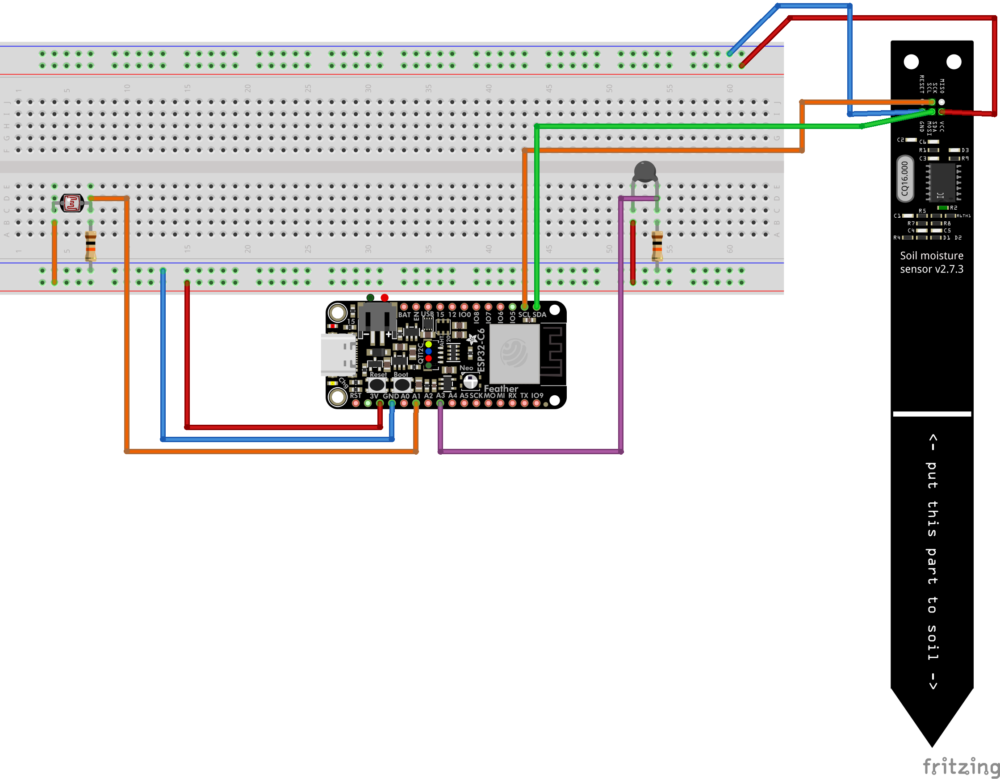
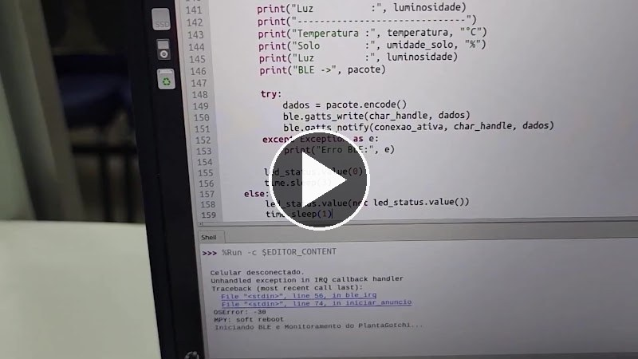
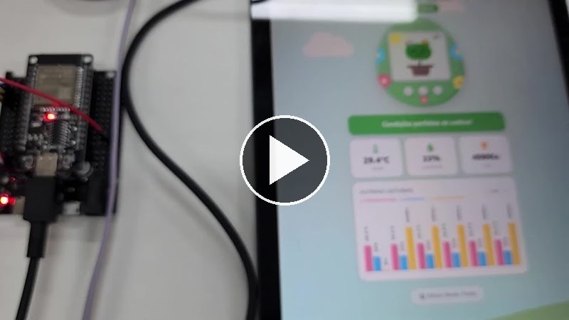
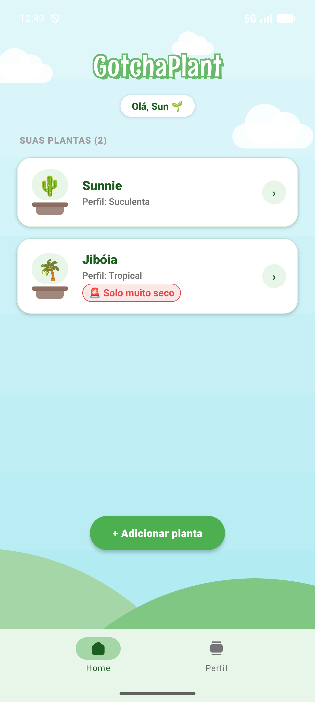
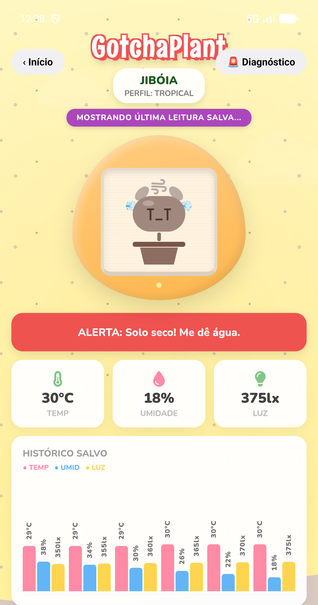
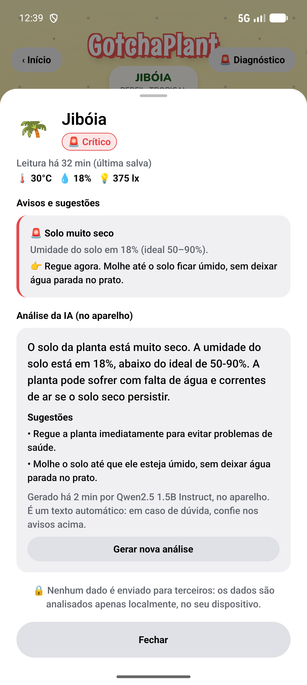
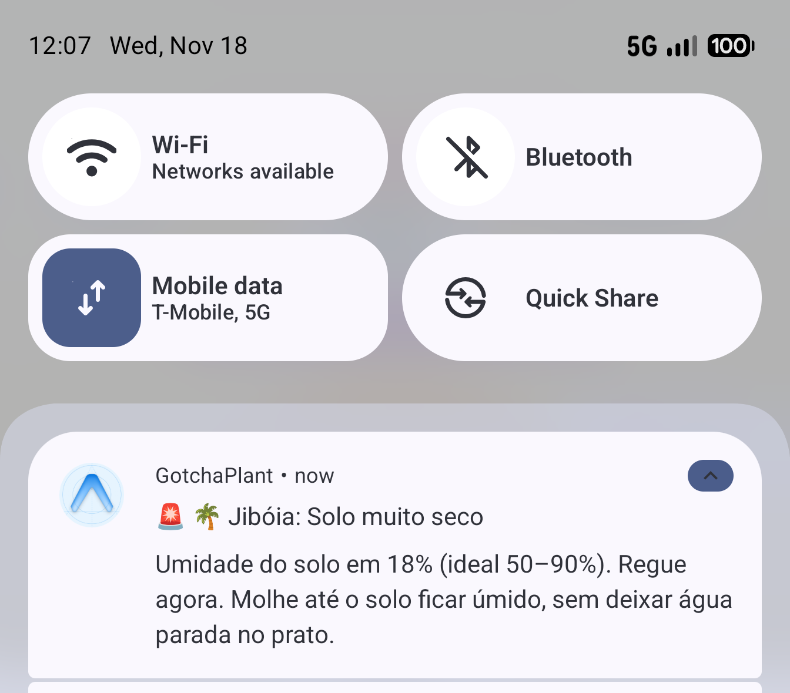
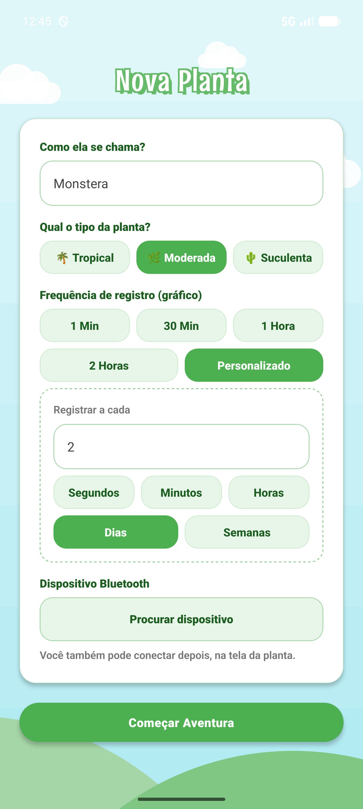
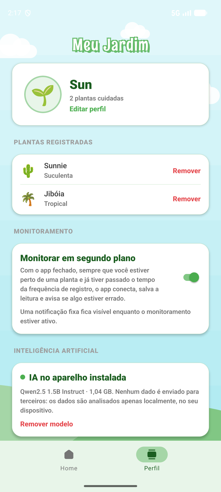
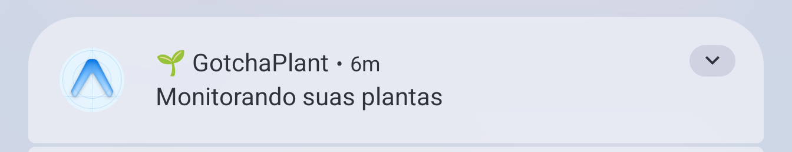

# 🌱 GotchaPlant

Monitor de plantas em estilo **Tamagotchi**: uma placa **ESP32** com sensores de temperatura, umidade do solo e luminosidade envia as leituras por **Bluetooth Low Energy (BLE)** para um app Android, que transforma os dados em um bichinho virtual, inspirado no Tamagotchi, com **diagnósticos, sugestões e alertas**.

> **Sobre esta versão**
> Este repositório é uma **implementação com ajustes novos sobre a versão realizada para a disciplina de Computação Pervasiva e Ubíqua (UNESP, 1º semestre de 2026)**.
> A versão entregue na matéria corresponde ao commit [`41e3041`](../../commit/41e3041) — _"GotchaPlant - V1 - Connecting and reading data from ESP32 board"_.

---

## 🔌 Protótipo

Montagem do hardware feita no **Fritzing** :

<p align="center">
  
</p>

| Componente                              | Função                                  | Ligação (conforme o diagrama)              |
| --------------------------------------- | --------------------------------------- | ------------------------------------------ |
| Placa ESP32 (Adafruit Feather ESP32-C6) | Lê os sensores e envia os dados por BLE | Alimenta a protoboard pelos pinos 3V e GND |
| Fotoresistor (LDR) + resistor           | Luminosidade                            | Divisor de tensão no pino **A1**           |
| Termistor + resistor                    | Temperatura                             | Divisor de tensão no pino **A3**           |
| Sensor de umidade do solo (v2.7.3)      | Umidade do solo                         | Barramento I²C (**SDA** / **SCL**)         |

O arquivo-fonte do Fritzing está em [`docs/prototipo.fzz`](docs/prototipo.fzz).

### 🎬 Vídeos da entrega final

Vídeos da versão apresentada na entrega final da matéria:

|                                                                                                 Comparação entre duas plantas                                                                                                  |                                                                                               Sensor de luz                                                                                                |
| :----------------------------------------------------------------------------------------------------------------------------------------------------------------------------------------------------------------------------: | :--------------------------------------------------------------------------------------------------------------------------------------------------------------------------------------------------------: |
| [](https://drive.google.com/file/d/15dgPw7sdz1TAP0crG3TGiKix_MLOw5we/view?usp=drive_link) | [](https://drive.google.com/file/d/1AV4xtqXG6N9nJJDWnpvWvdesXGifcEob/view?usp=drive_link) |
|                                                      [▶ Assistir no Google Drive](https://drive.google.com/file/d/15dgPw7sdz1TAP0crG3TGiKix_MLOw5we/view?usp=drive_link)                                                       |                                            [▶ Assistir no Google Drive](https://drive.google.com/file/d/1AV4xtqXG6N9nJJDWnpvWvdesXGifcEob/view?usp=drive_link)                                             |

---

## 📸 Telas

> As leituras das telas abaixo apresentam o funcionamento atual.

|                                                                Início                                                                 |                                                           Planta (Tamagotchi)                                                            |                                                           Diagnóstico + IA                                                            |
| :-----------------------------------------------------------------------------------------------------------------------------------: | :--------------------------------------------------------------------------------------------------------------------------------------: | :-----------------------------------------------------------------------------------------------------------------------------------: |
|  |  |  |
|                                               Lista de plantas com o status de cada uma                                               |                                                  Humor muda conforme o perfil da planta                                                  |                                                Avisos por regras + análise da IA local                                                |

|                                                             Notificação                                                              |                                                                      Nova planta                                                                       |                                                  Meu Jardim (perfil)                                                   |
| :----------------------------------------------------------------------------------------------------------------------------------: | :----------------------------------------------------------------------------------------------------------------------------------------------------: | :--------------------------------------------------------------------------------------------------------------------: |
|  |  |  |
|                                                Diz **qual planta** precisa de atenção                                                |                                                  Frequência pronta ou personalizada (seg. a semanas)                                                   |                                           Gerencia plantas e o modelo de IA                                            |

|                                                  Monitoramento em segundo plano                                                  |
| :------------------------------------------------------------------------------------------------------------------------------: |
|  |
|                          Notificação fixa enquanto o serviço está ativo (a opção fica em _Meu Jardim_)                           |

---

## Implementações

### 1. Perfil de usuário e várias plantas

- Cadastro local do usuário (nome + avatar) na primeira abertura.
- Lista de plantas na tela inicial; cada planta tem nome, tipo (**tropical**, **moderada** ou **suculenta**), frequência de registro e seu próprio dispositivo BLE.
- Perfil, plantas e histórico ficam salvos no aparelho (AsyncStorage) — fechar o app não apaga mais nada.

### 2. Diagnóstico que depende do tipo da planta

Antes, os limites eram fixos para todas as plantas. Agora um analisador por regras (`src/services/diagnosis/plant-analyzer.ts`) classifica cada leitura em **Tudo certo**, **Atenção** ou **Crítico**, com faixas diferentes para cada tipo:

| Tipo         | Temperatura ideal | Umidade do solo ideal | Luz (de dia) |
| ------------ | ----------------- | --------------------- | ------------ |
| 🌴 Tropical  | 20–32 °C          | 50–90 %               | 100–600 lx   |
| 🌿 Moderada  | 15–30 °C          | 30–80 %               | 100–600 lx   |
| 🌵 Suculenta | 15–35 °C          | 10–40 %               | 100–1000 lx  |

Por exemplo, 25 % de umidade é **crítico** para uma tropical, **atenção** para uma moderada e **normal** para uma suculenta. O analisador também:

- avisa **antes** do problema quando o solo está secando rápido (tendência do histórico);
- ignora escuridão à noite e só reclama de pouca luz se ela durar 30 min durante o dia;
- na tela da planta, usa a mediana das últimas leituras ao vivo, para um valor isolado com ruído não disparar alarme (no segundo plano é usada uma única leitura por verificação);
- identifica leituras impossíveis como **falha de sensor**, em vez de um falso alerta.

As faixas ficam em `src/constants/plant-care.ts` e as ideais coincidem com as usadas pelo Tamagotchi (`index.html`).

### 3. IA que roda no próprio celular (privada e local)

- Modelo de linguagem pré-treinado **Qwen2.5 1.5B Instruct** (formato GGUF, ~1,04 GB), executado com [`llama.rn`](https://github.com/mybigday/llama.rn) (llama.cpp para React Native).
- O modelo é baixado **uma vez** (tela _Meu Jardim_ ou dentro do diagnóstico). Depois disso, a análise funciona mesmo sem internet.
- A IA lê o **histórico salvo no aparelho** e os alertas calculados pelas regras, e escreve em português um diagnóstico, sugestões e avisos para aquela planta.
- **Nenhum dado é enviado para terceiros: os dados são analisados apenas localmente, no seu dispositivo.** (A internet só é usada para baixar o modelo uma vez e para carregar as fontes/ícones da tela do Tamagotchi; nenhuma leitura sai do celular.)
- A gravidade e as notificações vêm das regras, nunca do texto da IA — assim um erro do modelo não gera alarme falso.

### 4. Notificações dizendo qual planta precisa de atenção

- Notificação local quando uma leitura ao vivo fica **crítica** ou pede **atenção**, com o nome e o tipo da planta no título (ex.: `Jibóia: Solo muito seco`) e a ação recomendada no texto.
- Tocar na notificação abre a tela daquela planta.
- Sem spam: o mesmo alerta só se repete depois de 30 min (crítico) ou 3 h (atenção); se piorar de atenção para crítico, realiza o aviso no instante.
- Canais separados para alertas críticos e avisos.

### 5. Frequências novas

- Frequências de registro: **1 min, 30 min, 1 h, 2 h** ou **personalizada**, escolhendo um número (1 a 999) e a unidade: **segundos, minutos, horas, dias ou semanas**.

### 6. Monitoramento em segundo plano

- Opção **"Monitorar em segundo plano"** na tela _Meu Jardim_. Com ela ligada, o app mantém um serviço do Android (com uma notificação fixa "🌱 GotchaPlant — Monitorando suas plantas") que funciona mesmo com o app fechado.
- **Conecta uma vez, posteriormente realiza conexão automaticamente:** a planta lembra o dispositivo pareado. A cada minuto o serviço confere cada planta:
  - se **ainda não passou** o tempo da frequência de registro, não realiza nada (nem liga o Bluetooth);
  - se **já passou do prazo de verificação** e o celular está **perto da planta**, conecta, recebe uma leitura, salva no histórico, gera o diagnóstico, envia a notificação se houver alerta e desconecta;
  - se a planta está **fora de alcance**, tenta de novo depois de 2 min, 4 min, 8 min… até 15 min.
- Se a tela da planta estiver aberta e conectada, o serviço não interfere; e a tela da planta segue a mesma regra de frequência para salvar no histórico.

---

## Arquitetura

```
ESP32 + sensores ──BLE (JSON)──▶ App React Native (Expo)
                                 ├─ Tela da planta: WebView com o Tamagotchi (index.html)
                                 ├─ Analisador por regras ──▶ notificações locais
                                 ├─ Serviço em segundo plano (lê só quando a frequência venceu)
                                 ├─ IA local (llama.rn + Qwen2.5) ──▶ diagnóstico escrito
                                 └─ AsyncStorage + arquivos do app (tudo no aparelho)
```

**Comunicação BLE** (`src/services/ble/plant-ble-service.ts`)

- Serviço: `4fafc201-1fb5-459e-8fcc-c5c9c331914b`
- Característica (notify): `beb5483e-36e1-4688-b7f5-ea07361b26a8`
- Payload esperado: `{"temperatura": 26.5, "umidade_solo": 42, "luminosidade": 350}`

**Estrutura principal de `src/`**

| Pasta                     | Conteúdo                                                                   |
| ------------------------- | -------------------------------------------------------------------------- |
| `app/`                    | Telas (Expo Router): início, perfil, nova planta, tela da planta, cadastro |
| `components/`             | Cartões, folha de diagnóstico, cartão do modelo de IA, cenário (`garden/`) |
| `services/ble/`           | Conexão e leitura do ESP32                                                 |
| `services/diagnosis/`     | Analisador por regras                                                      |
| `services/ai/`            | Download do modelo, montagem do prompt e inferência local                  |
| `services/notifications/` | Política de alertas e envio das notificações                               |
| `services/background/`    | Serviço em segundo plano: regra de frequência, novas tentativas e leitura  |
| `storage/`                | Persistência local (perfil, plantas, histórico, alertas, análises)         |

**Tecnologias:** Expo SDK 57 · React Native 0.86 (New Architecture) · Expo Router · react-native-ble-plx · react-native-webview · llama.rn · expo-notifications · react-native-background-actions · expo-file-system · AsyncStorage · TypeScript.

---

## Como executar

Pré-requisitos: Node.js, Android Studio/SDK e um celular Android **64 bits** (ou emulador x86*64). O app usa módulos nativos (BLE, IA, notificações), então **não executa no Expo Go** — é preciso um \_development build*.

```bash
npm install
```

```bash
npx expo run:android
```

---

## Limitações conhecidas

- **Monitoramento em segundo plano:** o celular precisa estar ao alcance do Bluetooth da planta. O ciclo roda no máximo **1 vez por minuto**, então frequências menores que isso (ex.: 10 segundos) viram ~1 minuto com o app fechado. Se o usuário usar "Forçar parada" ou reiniciar o celular, o monitoramento só volta ao abrir o app. Alguns fabricantes (Xiaomi, Samsung etc.) encerram serviços para economizar bateria; pode ser preciso liberar o GotchaPlant na otimização de bateria.
- Com a tela apagada por muito tempo, o Android pode adiar as verificações (o serviço não mantém o processador acordado o tempo todo, para economizar bateria). Isso ainda não foi medido em um celular real.
- A IA exige um aparelho **64 bits** (arm64-v8a ou x86_64), ~1 GB livre para o modelo e alguns segundos a poucos minutos por análise, dependendo do processador.
- O texto da IA é automático e pode errar; em caso de dúvida, valem os avisos calculados pelas regras.
- As faixas críticas de cada tipo são valores padrão para plantas de interior; a calibração dos seus sensores se encontra em `src/constants/plant-care.ts`.
